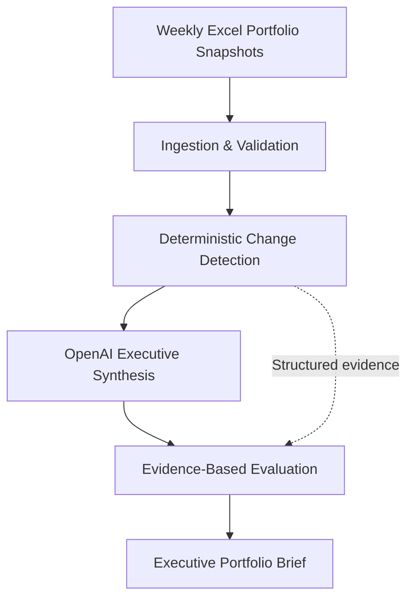

# AI Portfolio Intelligence Assistant

An evidence-grounded AI application that transforms weekly portfolio reporting data into executive-level insights.

**From weekly status updates to leadership decisions.**

A working, independent proof of concept that compares portfolio updates, identifies meaningful changes in delivery health, milestones, risks, and dependencies, and uses AI to prepare an executive briefing. Built with **synthetic data**; not an enterprise production deployment.

**Start here:** [Read the full sample executive briefing](examples/sample_executive_brief.md) · [See how it works](#how-it-works) · [Explore the technical architecture](#architecture)

## What does it actually produce?

Imagine receiving weekly updates for eight technology initiatives. Instead of manually scanning each update to work out what changed, this prototype produces a consolidated, decision-oriented briefing.

### Example: Weekly Executive Brief

*Digital Payments Modernization · 8 fictional initiatives · September 18–25, 2026*

| Leadership signal | What the example briefing surfaces |
|---|---|
| **Critical blocker** | **PAY-06:** Incomplete legacy data mapping prevents migration rehearsal; delivery health moved from amber to red. |
| **Milestone slipped** | **PAY-02:** Vendor certification delay moved a milestone by **21 days**; delivery health moved from green to amber. |
| **Decision needed** | **PAY-04:** Authentication architecture selection due **October 2, 2026**. |
| **Dependency exposure** | **PAY-03** depends on the delayed PAY-02 initiative; **PAY-08** is exposed to PAY-06 deterioration. |
| **Progress is not health** | **PAY-05** progressed from **45% to 65%** complete but still carries a high-severity reconciliation risk. |

**[View the complete sample executive briefing →](examples/sample_executive_brief.md)**

*This is an illustrative summary of the synthetic demonstration, not evidence of results achieved at an employer.*

## Why it matters

A dashboard can show the current status of each initiative. This prototype explores a complementary question: **What changed since last week, why does it matter, and what needs leadership attention?**

It illustrates a potential way to:

- Distinguish meaningful deterioration from routine updates.
- Connect an initiative's problems to downstream dependencies.
- Separate completion percentage from delivery health.
- Highlight decisions and blockers in a briefing that leaders can review quickly.

These are demonstrated capabilities, **not measured productivity savings or claims of production adoption**.

## How it works

1. **Read weekly updates:** Import structured Excel portfolio snapshots.
2. **Find the changes:** Compare the snapshots using deterministic calculations, including milestone movement and status changes.
3. **Write the briefing:** Use the OpenAI API to synthesize the structured findings into an executive narrative.
4. **Check the evidence:** Run targeted automated checks for selected identifiers and milestone-delay claims; human review is still required.

The project has an end-to-end working pipeline and **13 passing automated tests**. It does not have a graphical user interface; the linked sample briefing shows the output without requiring the reader to run the code.

---

## Overview

Enterprise leaders often manage complex portfolios spanning multiple teams, competing priorities, delivery risks, and interdependent initiatives. Traditional status reporting can make it difficult to distinguish routine progress updates from issues requiring leadership attention.

The AI Portfolio Intelligence Assistant combines deterministic change detection with generative AI to support executive reporting while retaining human oversight. The underlying portfolio comparisons are calculated in Python; AI is used for narrative synthesis, not as the source of calculated facts.

## Demonstration Data

The project uses a fully synthetic **Digital Payments Modernization** portfolio consisting of eight initiatives (PAY-01 through PAY-08).

Two weekly snapshots represent September 18 and September 25, 2026.

All initiative details, risks, dependencies, and decisions are fictional and intended solely for demonstration.

## Design Principles

1. **Evidence before synthesis:** Portfolio changes are calculated programmatically before being provided to the AI model.
2. **Separation of responsibilities:** Python handles deterministic comparisons; generative AI handles executive narrative synthesis.
3. **Traceability:** Structured comparison results provide the evidence supporting executive summaries.
4. **Automated validation:** Targeted checks flag unsupported identifiers and incorrect milestone-delay claims.
5. **Explicit limitations:** Passing automated checks does not guarantee that every AI-generated statement is accurate.


## Architecture

The application follows a five-stage pipeline:


### Key Components

| File | Responsibility |
|---|---|
| `run_pipeline.py` | Orchestrates the end-to-end workflow |
| `ingest_portfolio.py` | Validates Excel workbooks and produces structured JSON |
| `compare_portfolio.py` | Calculates portfolio changes between weekly snapshots |
| `synthesize_brief.py` | Uses the OpenAI API to generate an executive brief |
| `evaluate_brief.py` | Checks selected AI-generated claims against structured evidence |
| `build_templates.py` | Supports generation of demonstration workbook templates |
| `tests/` | Contains automated ingestion, comparison, and evaluation tests |

## Running the Application

### Prerequisites

- Python 3
- OpenAI API access
- Python packages: `openai` and `openpyxl`


### Installation

Create and activate a Python virtual environment:

```bash
python3 -m venv .venv
source .venv/bin/activate
```

Install the project's pinned dependencies:

```bash
python3 -m pip install -r requirements.txt
```

Configure your OpenAI API key as an environment variable:

```bash
export OPENAI_API_KEY="your-api-key"
```

Never commit actual API keys or credential files to Git.

### Execute the Pipeline

From the project directory:

```bash
python3 run_pipeline.py
```

The pipeline processes both weekly Excel workbooks, compares portfolio changes, generates an AI executive brief, and evaluates selected claims.

### Generated Outputs

| File | Description |
|---|---|
| `portfolio_week_1.json` | Validated Week 1 portfolio snapshot |
| `portfolio_week_2.json` | Validated Week 2 portfolio snapshot |
| `portfolio_changes.json` | Structured comparison evidence |
| `brief_v2.txt` | AI-generated executive brief |

The pipeline reports whether its configured evidence checks passed or failed.


## Automated Testing

The project includes 13 automated tests using Python's built-in `unittest` framework.

Run the tests from the project directory:

```bash
python3 -m unittest discover -s tests -v
```

### Test Coverage

| Category | Tests | Coverage |
|---|---:|---|
| Excel ingestion | 3 | Missing required columns, duplicate initiative IDs, invalid dependencies |
| Portfolio comparison | 3 | Known portfolio changes, status deterioration, progress versus delivery health |
| Executive brief evaluation | 7 | Critical evidence presence, identifier validation, milestone-delay verification, and negative tests |
| **Total** | **13** | |

The automated tests do not require OpenAI API calls. They use existing portfolio data, comparison evidence, and a previously generated executive brief.

### Validation Approach

The application separates deterministic calculations from AI-generated narrative.

The evaluation module checks selected claims, including:

- Whether referenced initiative IDs exist in the portfolio.
- Whether referenced risk and blocker IDs appear in the supported evidence.
- Whether explicitly reported milestone delays agree with calculated values.

Negative tests demonstrate that the evaluator can identify deliberately introduced errors, including an invented initiative and an incorrect milestone delay.

## Limitations

This project is a working demonstration, not a production-ready enterprise reporting platform.

Current limitations include:

- The evaluator does not verify every factual claim in the generated brief.
- Decision deadlines, risk severity descriptions, and causal statements are not comprehensively validated.
- The pipeline uses two predefined weekly snapshots rather than a continuously updated data source.
- The application does not provide a graphical user interface.
- AI-generated summaries require human review before use in consequential decisions.

## Project Status

The following capabilities have been implemented and tested:

- Excel ingestion and validation
- Week-over-week portfolio comparison
- AI-generated executive briefing
- Automated evidence evaluation
- End-to-end pipeline execution
- 13 passing automated tests

Potential future enhancements include broader claim validation, additional reporting periods, structured evaluation reports, and an interactive dashboard.

## Disclaimer

All portfolio data is synthetic. This project does not contain or represent confidential information from any employer or client.